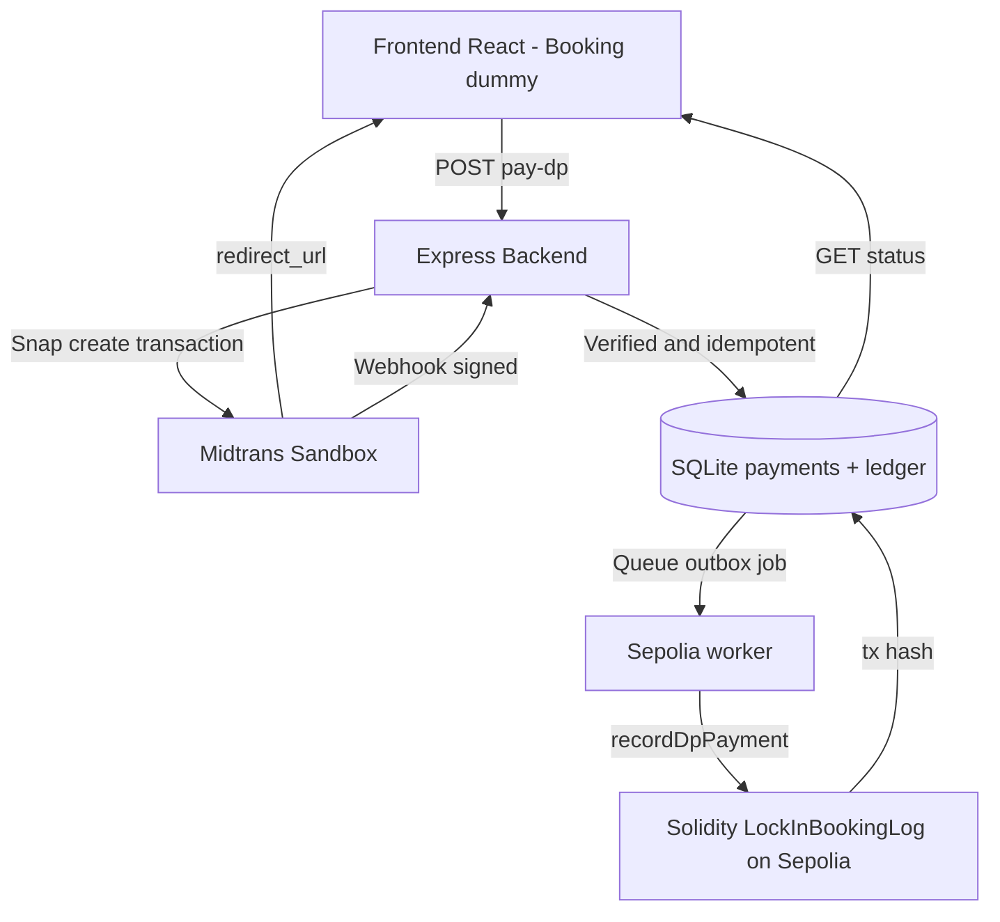

# Arsitektur Sprint 1

## Pilihan teknis

- `GET /api/demo`: status booking/payment/ledger/blockchain untuk UI demo.
- `POST /api/bookings/LOCKIN-DEMO-001/pay-dp`: meminta checkout Snap, nominal diambil dari database, bukan input browser.
- `POST /webhooks/midtrans`: validasi signature SHA512 + cek nominal dan order_id sebelum ubah state.
- `blockchain_jobs`: outbox agar RPC Sepolia lambat tidak menghambat HTTP webhook.
- ABI contract hanya dua fungsi: `recordDpPayment` dan `recordedPayments`.
- Dibutuhkan URL tunnel HTTPS publik jika ingin menerima webhook ketika backend berjalan lokal.
